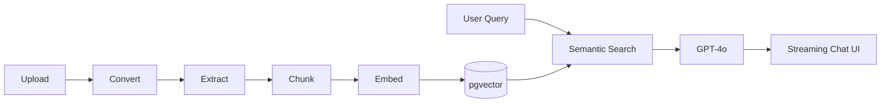

<!-- Header -->

 

  

---

## 👨‍💻 About Me

I'm a **Senior Frontend Engineer** from India with **6 years** of experience building consumer web and mobile products on modern JavaScript frameworks. My work spans **design systems, frontend platform, and developer tooling**, and I've recently extended into **AI**: a RAG platform with a streaming chat UI, and an MCP server for AI coding agents.

- 🏢 Currently a **Senior Software Engineer at Zepto** (Bengaluru)
- 🤖 Building AI dev tooling that grounds coding agents in our in-house component library
- ⚡ Obsessed with developer experience, build and deploy speed, and UI consistency
- ✍️ Writing about real-time updates, deep links and frontend engineering
- 🧩 In my free time I solve problems on LeetCode and read tech articles

---

## 🚀 What I Do

| 🎨 Design Systems | ⚙️ Frontend Platform | 🤖 AI & LLM | 📱 Mobile |
|:--|:--|:--|:--|
| Figma → Code token pipeline | Serverless deploy pipelines | RAG with pgvector | React Native + Expo |
| Versioned component packages | CDN and cache strategy | SSE token streaming | Deep & universal links |
| CSS / SCSS / MUI / Tailwind output | Reusable CI/CD workflows | MCP servers for coding agents | Hybrid apps for vendors |

---

## 🛠️ Tech Stack

**Languages**

**Frameworks & Libraries**

**AI & LLM**

**Cloud, DevOps & Tools**

> AWS: S3, CloudFront, CodeArtifact, Amplify · Also: ImageKit, Java, Spring, MySQL, Firebase

---

## 💼 Experience Highlights

### 🟣 Senior Software Engineer · Zepto &nbsp;`Dec 2024 – Present`

- 🤖 **AI dev tooling:** built an MCP server that grounds coding agents in the in-house component library and design tokens (**40% of AI-generated code accepted**), plus a PR-review agent running on every PR
- 🎨 **Figma-to-Code:** a Figma plugin extracts design tokens, and GitHub Actions compile them to CSS/SCSS/MUI/Tailwind and publish a versioned CodeArtifact package. **UI inconsistencies down 30–40%**
- 🚀 **Serverless deploys:** replaced Kubernetes orchestration with S3 + CloudFront on reusable GitHub Actions. **Deploy time 20–25 min → 3–4 min (~85%)**
- 🖼️ **Media delivery:** moved to ImageKit with MD5 content-hash cache versioning. Ended stale-asset bugs, **cut invalidations 97%** and reached a **100% cache-hit ratio**
- 🧪 **QA environments:** feature-specific environments and reusable workflows, **cutting QA time by 20–30%**
- 📊 **Brand Analytics (ATOM):** React Native + Expo app giving **1,500+ vendors** real-time brand insights, with an estimated **₹40 Cr profit** in its first rollout
- 🍳 **Kitchen Management System** for **250+ stores:** automated order workflows, saving ~90 seconds per order and cutting order defects by 5%

### 🟠 Software Development Engineer · BharatPe &nbsp;`Jun 2022 – Dec 2024`

- ⚖️ Built a merchant **dispute-resolution system**, bringing closure time inside 10 business days and reducing chargebacks
- 🔐 Developed an **RBAC framework** with multiple roles and granular permissions to secure sensitive payment data
- 🌐 Integrated **multilingual support** across payment products, driving **15% higher merchant adoption**
- 🔗 Enabled independent development of **multiple mini-products inside a native app**, with seamless transitions via deep links and universal links

### 🟢 Software Development Engineer, Frontend · Roadzen &nbsp;`Mar 2021 – May 2022`

- 🚗 Architected a centralized **fleet management dashboard** with real-time vehicle insights
- 🗺️ Built **live vehicle tracking** with Mapbox + Socket.io, replacing Google Maps and **cutting mapping costs by 40%**
- 🛡️ Built AI-powered alerts and **CASL-based RBAC**, reducing unauthorized API calls by 30%
- ⚡ Implemented **AWS Amplify CI/CD**, cutting go-live timelines by 70–90%

### 🔵 Software Developer, Frontend · Fudr &nbsp;`Aug 2020 – Feb 2021`

- 🍽️ Built an end-to-end **restaurant management platform** (menus, KOTs, inventory) plus a customer ordering and payment interface
- 📍 Delivery and upsell modules with Google Maps API and smart recommendations, **boosting restaurant revenue by ~15%**
- 💸 Integrated e-wallet and analytics for instant cashbacks/refunds
- 🎁 Built **Fudr Engage & Rewards** (campaigns, feedback, loyalty) across Android, iOS and web with React Native + Expo

---

## 🧠 Featured Project: Argus.AI

**Multi-tenant RAG platform** for enterprise natural-language search over internal documents.

- 🔎 OpenAI **GPT-4/4o** with **pgvector** semantic search, tenant-isolated across a **25+ table Prisma/PostgreSQL** schema
- 📥 **7-stage ingestion pipeline** (upload → convert → extract → chunk → embed → store) for PDF/DOCX/PPTX/XLSX via Adobe PDF Extract, with live progress over **SSE**
- 💬 **Token-by-token streaming** into a React chat UI with multi-turn memory, 128K context trimming, page-level citations, and a prompt config layer tunable without redeploy

---

## 📂 Open Source & Side Projects

| Project | Description | Stack |
|:--|:--|:--|
| [**mail-tracker**](https://github.com/SachinSh97/mail-tracker) | Email open tracking, so you know when a sent mail has been read |   |
| [**interceptor**](https://github.com/SachinSh97/interceptor) | Request/response interceptor for inspecting and modifying network calls |  |
| [**streak-up**](https://github.com/SachinSh97/streak-up) | Habit and streak tracker to build consistency day by day |   |
| [**social-media-platform-service**](https://github.com/SachinSh97/social-media-platform-service) | Backend service for a social media platform |   |
| [**Tasker-App**](https://github.com/SachinSh97/Tasker-App) | Task management web app with multiple states, a lightweight Jira-style board |  |
| [**contact-list-app**](https://github.com/SachinSh97/contact-list-app) | Single-page app to store contacts with full CRUD |  |
| [**TO-DO-LIST**](https://github.com/SachinSh97/TO-DO-LIST) | Single-page app for CRUD operations on a task list |  |
| [**Data-Structure-and-Algorithms-using-java**](https://github.com/SachinSh97/Data-Structure-and-Algorithms-using-java) | Data structure and algorithm problems in Java |  |

---

## ✍️ Writing

- 📝 [Real-time updates with Server-Sent Events and ReactJS](https://www.linkedin.com/in/sachinsh97)
- 📝 [Setting up Universal Links and Deep Links in an Expo App](https://www.linkedin.com/in/sachinsh97)

---

## 📊 GitHub Stats

 

---

## 🎓 Education

**B.Tech, Computer Science & Engineering** · Jaipur Engineering College & Research Centre · 2021

---

## 📫 Let's Connect

I'm open to conversations about **frontend platform, design systems, and AI-assisted developer tooling**.

 

